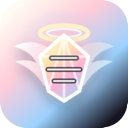
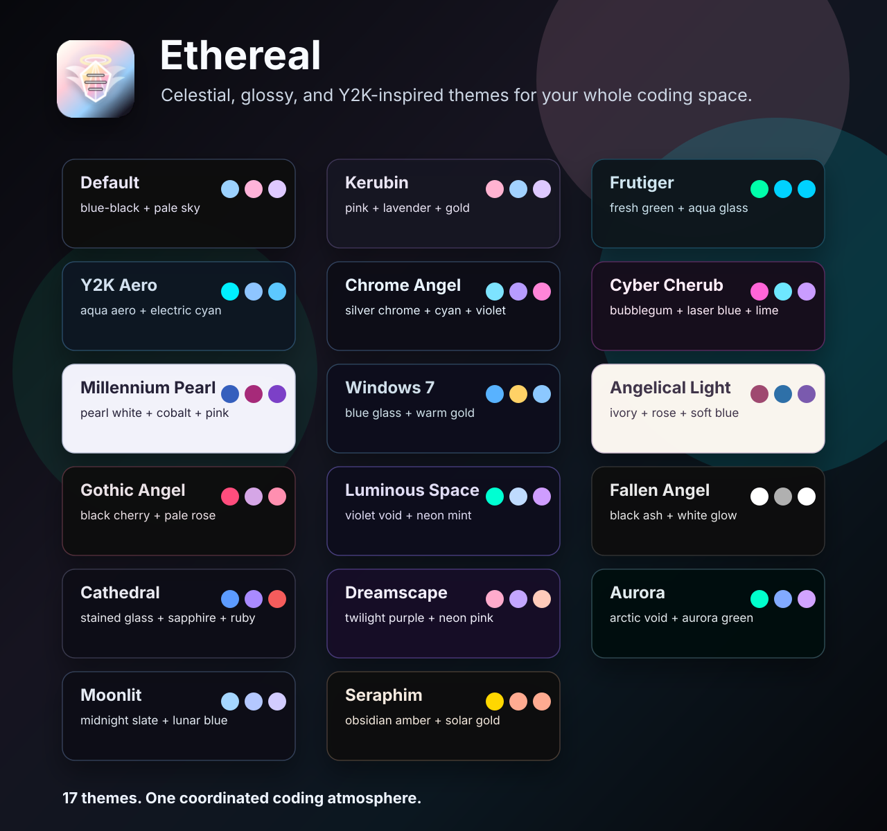
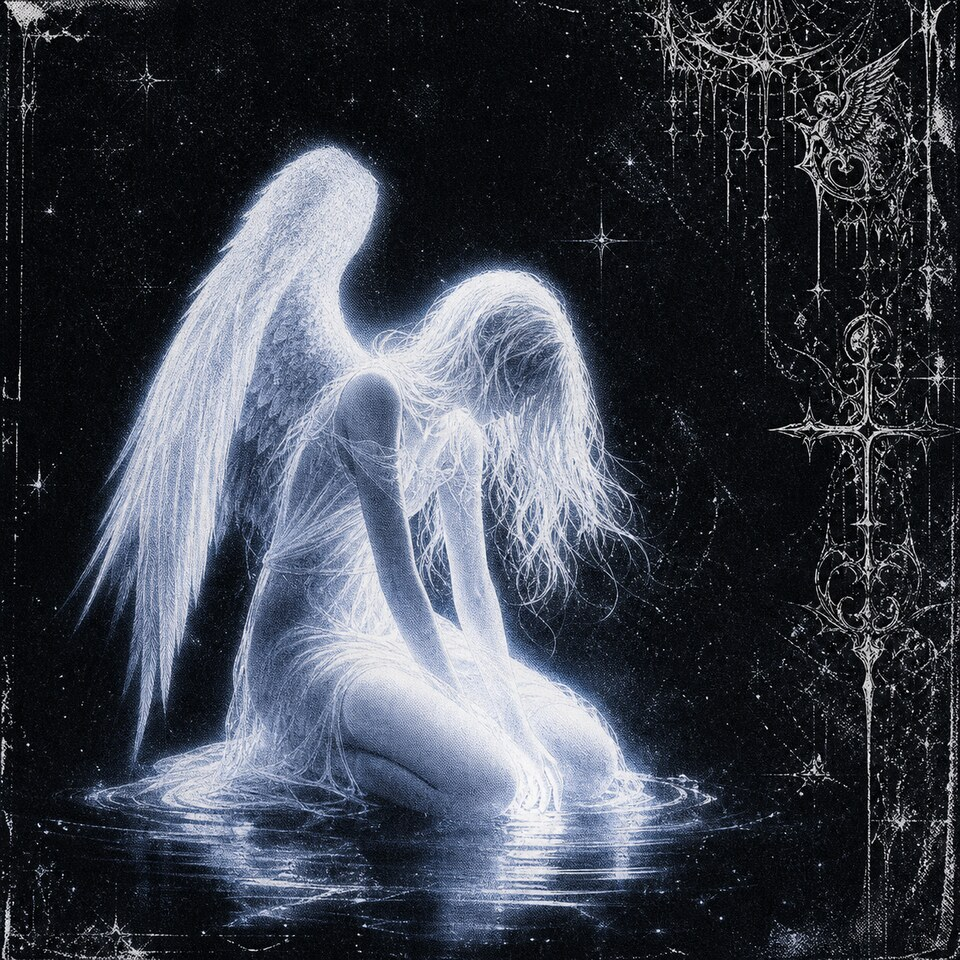

  

<h1 align="center">Ethereal</h1>

  Celestial, glossy, and Y2K-inspired themes for your whole coding space.

  <strong>Seventeen coordinated themes for VS Code, with matching palettes for terminals and coding agents.</strong>

  

## Install

1. Open **Extensions** in VS Code with `Ctrl+Shift+X`.
2. Search for **Ethereal Themes** and select **Install**.
3. Press `Ctrl+K Ctrl+T` to open the theme picker.
4. Choose any `Ethereal-Theme` variant.

On macOS, open Extensions with `Cmd+Shift+X` and the theme picker with `Cmd+K Cmd+T`.

## Beyond syntax colors

Every Ethereal variant is fully coordinated across:

- editor backgrounds, selections, line numbers, brackets, and syntax highlighting;
- the activity bar, sidebars, tabs, panels, menus, inputs, and notifications;
- Git states, diffs, debugging, testing, and notebooks;
- the integrated terminal, including its full ANSI color palette; and
- VS Code Chat, inline chat, agent sessions, and agent edit surfaces.

## Themes

| Theme | Appearance | Feel |
| --- | --- | --- |
| **Default** | Dark | Deep blue-black with soft sky highlights for an easy everyday setup. |
| **Kerubin** | Dark | Cherubic pink, lavender, mint, and gold. |
| **Frutiger** | Dark | Fresh green and aqua inspired by glossy Frutiger Aero interfaces. |
| **Y2K Aero** | Dark | Translucent midnight glass with playful electric cyan. |
| **Chrome Angel** · New | Dark | Polished silver-blue surfaces, icy cyan, and electric violet. |
| **Cyber Cherub** · New | Dark | Bubblegum pink, laser blue, and acid-lime accents. |
| **Millennium Pearl** · New | Light | Pearl-white chrome with cobalt, violet, and hot-pink details. |
| **Windows 7** | Dark | Cool desktop glass with nostalgic blue and warm gold. |
| **Angelical Light** | Light | Warm ivory with gentle rose, lavender, blue, and mint. |
| **Gothic Angel** | Dark | Black-cherry shadows, crimson, and chapel-glass rose. |
| **Luminous Space** | Dark | A deep violet void lit by mint starlight. |
| **Fallen Angel** | Dark | Ash-black monochrome with white glow and sharp red warnings. |
| **Cathedral** | Dark | Sapphire, ruby, and emerald light through gothic glass. |
| **Dreamscape** | Dark | Dreamy 90s vaporwave pastels over twilight purple. |
| **Aurora** | Dark | Magnetic green and violet ribbons across an arctic night. |
| **Moonlit** | Dark | Quiet lunar blue on frosted midnight surfaces. |
| **Seraphim** | Dark | Obsidian warmth with radiant solar gold. |

## Terminals and coding agents

Want the same atmosphere outside VS Code? The GitHub repository includes matching palettes for:

- opencode and Claude Code;
- Alacritty, Ghostty, Kitty, and WezTerm.

These companion palettes are installed separately from the VS Code extension. Follow the [terminal and coding agent setup guide](https://github.com/Ethereal-Lemons/Ethereal-Theme/blob/main/tui/README.md) to bring your chosen Ethereal theme to the rest of your workspace.

## Tips

- Switch variants anytime with `Ctrl+K Ctrl+T` (`Cmd+K Cmd+T` on macOS).
- Every variant recolors the integrated terminal automatically, including all ANSI colors.
- Pair Ethereal with a simple icon theme to let the palette stay in focus.
- Use **Millennium Pearl** or **Angelical Light** when you want a brighter workspace.

  

## License

See [LICENSE](LICENSE).
